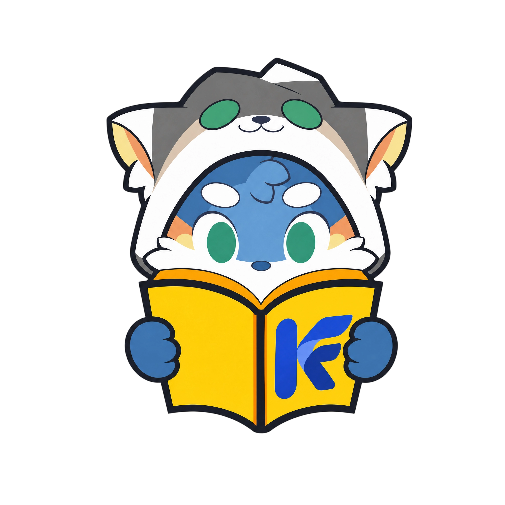

# KenFutWiki

<p align="center">
  
</p>

<p align="center">
  AI 大模型驱动的开源知识库与内容运营系统，基于 PandaWiki（AGPL-3.0）发行，保留上游历史、版权及更新接缝。
</p>

<p align="center">
  <a target="_blank" href="http://kenfutwiki-demo.future-you.top">🖥️ 在线演示</a> &nbsp; | &nbsp;
  <a target="_blank" href="docs/integrations/README.md">📖 产品接入</a> &nbsp; | &nbsp;
  <a target="_blank" href="docs/engineering/upstream-integration.md">🔧 上游合并</a>
</p>

## 👋 项目介绍

KenFutWiki 帮助你快速构建智能化的 **产品文档、技术文档、FAQ、博客系统**，在保留上游 AI 知识库全部能力的基础上，面向公开内容运营补齐了一整层功能：内容双频道（文档 + 文章）、通用产品转化漏斗、开放 API（MCP）、完整国际化，以及部署与品牌自主。

<p align="center">
  
</p>

## 🔥 功能与特色

### 内容与 AI

- AI 驱动智能化：AI 辅助创作、AI 辅助问答、AI 辅助搜索。
- 强大的富文本编辑：兼容 Markdown 和 HTML，支持导出 word、pdf、markdown 等多种格式。
- 双频道内容：同一篇内容可发布为文档（`/node/...`）或文章（`/blog/{slug}`），支持分类、标签、精选与相关推荐。
- 阅读体验：预计阅读时长、正文图片点击查看原图、Cmd/Ctrl+K 全站搜索、页面级"有帮助吗"投票。

### 运营与集成

- 转化漏斗：CTA 按钮带来源跳转，产品回传注册与首次产出事件，30 天归因，漏斗逐段可查（[产品接入](docs/integrations/README.md)）。
- Webhooks 事件推送：文档发布、删除、恢复、评论与反馈事件实时通知外部系统。
- RSS 2.0 订阅：博客频道提供 `/rss.xml` 端点。
- 文档反馈闭环：读者提交反馈（支持截图），管理端反馈中心审核处理。

### 知识库治理

- 文档模板：保存常用结构，新建文档一键复制。
- 版本对比：发布版本间内容差异逐行对比。
- 回收站：删除的文档可恢复或彻底清除。
- MCP Server：通过 Model Context Protocol 向外部 Agent 开放知识库读写（[MCP 接入](docs/integrations/mcp-server.md)）。
- 多语言：内容语言字段、译本路由、语言切换与 AI 翻译，管理端与应用端全量国际化。

### 部署与自主

- 存储可插拔：任意 S3 兼容对象存储（内置 MinIO、阿里云 OSS、雨云 S3 等），管理页热切换（[存储配置](docs/engineering/storage-config.md)）。
- 基础设施解耦：PostgreSQL / Redis / NATS 支持外部托管部署。
- 多实例共存：会话键名 `kfw` 前缀隔离，同域名可与其他实例并存。
- CI/CD：tag 推送自动构建四个镜像（api / consumer / admin / app）发布 Docker Hub。

## ⚡️ 界面展示

| 控制台                                           | Wiki 网站前台                                    |
| ------------------------------------------------ | ------------------------------------------------ |
|  |  |
|  |  |

## 🚀 部署

### Docker Compose 部署

参考 [deploy/demo/docker-compose.demo.yml](deploy/demo/docker-compose.demo.yml)（完整生产拓扑：postgres(zhparser) / redis / nats / caddy / api / consumer / admin / app）：

1. 准备一台 Linux 服务器与 Docker 20+。
2. 复制 [deploy/demo/env.example](deploy/demo/env.example) 为 `.env`，生成数据库、缓存、JWT 等密钥。
3. 配置外部 RAG 服务地址（`RAG_CT_RAG_BASE_URL`）与 S3 兼容存储。
4. `docker compose -f docker-compose.demo.yml up -d`，按 caddy 配置绑定域名。

镜像（Docker Hub，`iskenkenya` 命名空间）：

```
iskenkenya/kenfutwiki-api      # Go 后端 API
iskenkenya/kenfutwiki-consumer # 异步消费
iskenkenya/kenfutwiki-admin    # 管理控制台
iskenkenya/kenfutwiki-app      # 公开站点
```

### 配置 AI 模型

首次登录管理端会提示配置 AI 模型，可一键配置或手动接入任意 OpenAI 兼容供应商（凭证复用、自定义供应商、模型目录均已内置）。

<div align="center">
  
  <p><em>一键自动配置 AI 模型</em></p>

  
  <p><em>手动自定义配置 AI 模型</em></p>
</div>

### 创建知识库

"知识库"是一组文档的集合，每个知识库对应一个独立的 Wiki 站点，支持独立域名或路径前缀。


## 🏗️ 项目结构

- `backend/`：Go 后端（handler / usecase / repo 分层），含迁移与 MCP。
- `web/admin/`：React + Vite 管理控制台。
- `web/app/`：Next.js 公开站点（SSR、SEO、i18n）。
- `sdk/`：SDK 代码。
- `docs/`：[产品接入](docs/integrations/README.md)与[工程文档](docs/engineering/upstream-integration.md)。
- `deploy/`：部署参考栈。

更多细节见 [PROJECT_STRUCTURE.md](PROJECT_STRUCTURE.md)。

## 🙏 赞助与鸣谢

- **算力赞助**：天技谷（福州）科技有限公司
- **上游项目**：[PandaWiki](https://github.com/chaitin/PandaWiki)（chaitin）

## 🙋‍♂️ 贡献

欢迎提交 [Pull Request](https://github.com/IsKenKenYa/KenFutWiki/pulls) 或创建 [Issue](https://github.com/IsKenKenYa/KenFutWiki/issues)。贡献流程见 [CONTRIBUTING.md](CONTRIBUTING.md)，安全漏洞报告见 [SECURITY.md](SECURITY.md)。

## 📝 许可证

本项目采用 GNU Affero General Public License v3.0 (AGPL-3.0) 许可证。这意味着：

- 你可以自由使用、修改和分发本软件
- 你必须以相同的许可证开源你的修改
- 如果你通过网络提供服务，也必须开源你的代码
- 商业使用需要遵守相同的开源要求
